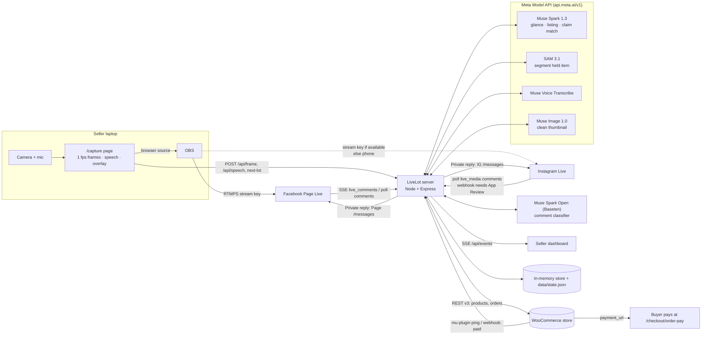

# LiveLot: build plan

> **What this file is:** the working plan, written on 31 Oct 2026 when the build started (inside the hackathon build period, 27 Oct – 4 Nov), and kept as the build log. The schedule ticks weren't all kept up to date and some ideas were dropped (Spark Open on Baseten, for example). [`README.md`](README.md) describes what was actually built. §8 and §9 record what we verified and changed along the way.

**One line:** You hold an item up on Facebook or Instagram Live and describe it. LiveLot lists it in WooCommerce. A viewer comments "sold" and gets a private message with their pay link within seconds. No double-selling, no spreadsheet after the show.

**Hackathon:** Meta Global AI Developer Hackathon, Indie track.
- **Deadline:** Wed 4 Nov 21:00 ET = **Thu 5 Nov 02:00 UK**.
- **Judging:** Impact 30 · Meta tooling 25 · Technical depth 20 · Demo 25.
- **Bonus categories we can target:** Most Viral (X post), Agentic. (Open-Weight was dropped: we only use the Meta Model API.)

---

## 1. Architecture

### Components (all in this repo)
| Component | File | Role |
|---|---|---|
| Studio page | `capture/` | Camera preview for OBS. Sends 1 frame/s, speech text and the "Next lot" hotkey. Shows the lot and price on screen. |
| Server | `src/server.js` | REST, SSE and webhooks. One process, so reservations are serialised and can't race. |
| Lot pipeline | `src/pipeline/lots.js`, `src/vision/*` | Cue → Spark glance (is something being held, and what noun) → SAM 3.1 → cutout → Muse Image clean-up → Spark listing → seller approves → Woo product |
| Claim pipeline | `src/pipeline/claims.js`, `src/agents/*` | Classify comment → match lot/variant → reserve or waitlist → bundled pending order → private reply → expiry sweep |
| Platform adapters | `src/adapters/meta/*` | FB live comments (SSE or poll), IG live_media poll and webhook parser, private replies, signature check |
| Commerce adapter | `src/adapters/woo/client.js`, `woo-plugin/` | Products and variations, pending orders and line edits, the guest order-pay fix, paid ping |
| Replay | `src/replay/`, `fixtures/` | Deterministic show used for tests and the demo fallback |
| Dashboard | `dashboard/` | Approve listings, review ambiguous claims, undo, mark paid |

### Data model (`src/domain/models.js`)
- **Show** `{id, platforms[], fbLiveVideoId, igMediaId, status: live|ended, startedAt, recordingPath}`
- **Item (lot)** `{id, showId, lotNumber, status: detecting|draft|published|sold_out, concept, title, description, price, variants[], stock{variant→qty}, shownAt, transcript[], imagePath, wooProductId, wooVariationIds{}, needsReview}`
- **Buyer** `{id: "platform:userId", platform, platformUserId, displayName, email?}`
- **Claim** `{id, showId, itemId, buyerId, variant, qty, commentId, platform, text, at, state, confidence, orderId, expiresAt, history[]}`
- **Order** `{id, showId, buyerId, wooOrderId, paymentUrl, claimIds[], lineIds{claimId→wooLineId}, status: open|paid|cancelled}`

There is one open order per buyer per show. Each new claim adds a line to it, and an expired or cancelled claim removes its line (Woo `line_items:[{id, quantity:0}]`).

### Claim state machine (`src/domain/claimMachine.js`)

```mermaid
stateDiagram-v2
  [*] --> detected
  detected --> matched: match
  detected --> needs_review: lowConfidence
  detected --> ignored: notAClaim
  needs_review --> matched: approve (seller)
  needs_review --> ignored: reject
  matched --> reserved: reserve (stock>0)
  matched --> waitlisted: conflict (sold out)
  waitlisted --> reserved: promote (earlier claim released)
  reserved --> invoiced: invoice (Woo line + private reply)
  reserved --> expired: expire
  invoiced --> paid: pay (Woo processing)
  invoiced --> expired: expire (15 min TTL)
  detected --> cancelled: cancel
  matched --> cancelled: cancel
  reserved --> cancelled: cancel/undo
  invoiced --> cancelled: cancel/undo
  waitlisted --> cancelled: cancel
  paid --> [*]
```

**Matching rules:**
1. An explicit "lot N" wins.
2. Otherwise use the lot on screen 8 s before the comment, because of stream latency.
3. A descriptive comment ("the blue mug") goes to Spark with the recent lot cards.
4. Confidence below 0.6 goes to `needs_review`.

A size given in the comment picks the variation, and an item with a single size takes it automatically. A duplicate claim from the same buyer for the same lot is cancelled.

**Why LiveLot holds stock itself:** a Woo `pending` order does **not** reduce stock (verified below). LiveLot's in-memory counter is the source of truth during the show. Woo stock is decremented when the order is paid (processing).

### API list (LiveLot server)
| Method | Path | Purpose |
|---|---|---|
| GET | `/health`, `/api/state`, `/api/events` (SSE) | status, snapshot, live feed |
| POST | `/api/show/start`, `/api/show/end` | start the show (finds the current FB live video ID) and start polling |
| POST | `/api/frame`, `/api/speech`, `/api/next-lot` | studio inputs |
| POST | `/api/lot/:id/draft`, `/publish`, `/override` | listing approval and fixes |
| POST | `/api/claim/:id/approve`, `/api/claim/:id/undo` | seller review |
| POST | `/api/order/:id/paid` | manual "paid" (or mu-plugin ping) |
| POST | `/api/comment` | inject a comment (demo/replay) |
| GET/POST | `/webhooks/meta` | verify token; signed `X-Hub-Signature-256` payloads |

### Stack (solo-buildable)
- **Runtime:** Node 22+ (Node 20 is end-of-life), plain ESM JS. Dependencies: `express`, plus optional `sharp` for cropping. Model and Graph calls use built-in `fetch` (no `openai` SDK, so the multipart ASR call and the explicit auth header work the same way).
- **Data:** no database; an in-memory store plus a JSON snapshot.
- **Frontend:** plain HTML; SSE to update the dashboard.
- **Tools:** cloudflared for the HTTPS tunnel, OBS to stream. The studio page encodes 16 kHz mono WAV itself, so ffmpeg is only needed if we send video to SAM.
- **Store:** WooCommerce on any HTTPS host. Rob knows it well; Shopify is listed as a "next" adapter.

---

## 2. Verified API facts (checked 31 Oct 2026)

### Meta Model API ([quickstart](https://dev.meta.ai/docs/quickstart))
- **Base URL and auth:** base URL `https://api.meta.ai/v1`, OpenAI-SDK compatible. The `Authorization: Bearer $MODEL_API_KEY` header must be set explicitly, because the SDK doesn't read that env var.
- **Muse Spark:** model `muse-spark-1.3`, used through the **Responses API** `POST /v1/responses`. The `-contributor` variants are cheaper, but Meta uses their data to improve its products, so we use the normal one.
- **Errors:** `404 model_not_found` is also what you get when your team lacks access to the model; `401 invalid_api_key`.

### SAM 3.1 ([segmenting](https://dev.meta.ai/docs/sam/segmenting))
- **Model and endpoint:** model `sam-3.1`, also via `/v1/responses`. The pricing page writes `sam-3-1`, so it is configurable via `SAM_MODEL`.
- **Prompting:** one short noun phrase per request. Commands and questions are unreliable, and comma lists return 0 matches. **So Spark names the noun first and SAM segments it.** Box and point prompts are also supported.
- **Inputs:**
  - `input_image` takes a URL or a base64 data URL.
  - `input_video` takes a URL or a `file_id` from `POST /v1/files` (purpose `user_data`).
  - Video must be **MP4/MOV only** (H.264/H.265/MPEG-4); WebM and VP9 are not accepted, so the browser recording has to be converted with ffmpeg.
- **Limits:** ≤15,000 frames and ≤16 objects per request.
- **Output:** `<|box;x1=..;y1=..;x2=..;y2=..;w=..;h=..|><|mask;...|>` tokens, one line per frame. Zero matches is a valid result, not an error.
- **Options:** metadata `include_confidence:"true"`, `mask_encoding:"one_bit"`. Parsers: `@meta-sam/parser` / `meta-sam-parser`.
- **Price:** $2.50 per 1k images, $0.20 per 1k video frames (50-frame minimum).

### Voice Transcribe ([guide](https://dev.meta.ai/docs/speech-to-text), [API ref](https://dev.meta.ai/docs/api-reference/voice/transcribe))
- **Model:** `muse-voice-transcribe-1.0`.
- **Batch:** `POST /v1/asr/transcribe`, sent as multipart with a `request` JSON part and an `audio` part.
  - Audio must be WAV, mono, s16, 16 or 24 kHz.
  - Limits: ≤10 min, ≤32 MB.
  - Supports `keywords` biasing, which we use for item vocabulary.
- **Realtime:** `wss://api.meta.ai/v1/asr/realtime`.
  - Auth goes in the **first JSON frame**, not a header.
  - Audio is PCM 24 kHz paced in real time, with at most 5 s backlog; sessions last up to 60 min.
  - Modes: PUSH_TO_TALK / ENDPOINTING / DIARIZATION.
  - **Turn-level timestamps only** (no word timestamps).
- **Price:** $0.18/h.

### Muse Image ([edit image](https://dev.meta.ai/docs/api-reference/images/edit-image))
`muse-image-1.0`, called with `POST /v1/images/edits` and body `{model, prompt, images:[{image_url}], n}`. Costs $0.01 per image.

### Muse Spark Open on Baseten ([Baseten Model APIs](https://docs.baseten.co/inference/model-apis/overview), [launch note](https://www.baseten.co/resources/changelog/muse-spark-open-and-nemotron-35-super-vl-available-on-baseten/))
- **Endpoint:** `https://inference.baseten.co/v1/chat/completions` with model `meta-models/muse-spark-open`. The hackathon Discord quotes `...-open-1026`, so this is set by the `SPARK_OPEN_MODEL` env var.
- **No JSON mode / structured output.** We prompt for JSON and parse it defensively, and `n>1` returns a 400 error.
- **Discord reports:** empty content with `finish_reason=length` (so we use `max_tokens` 2048 and low reasoning effort, and throw on empty), plus `model_not_found` from some EU regions.
- **Fallback chain:** Spark Open → Spark 1.3 → regex.

### Facebook Live comments ([interact with viewers](https://developers.facebook.com/documentation/live-video-api/interact-with-viewers.md))
- **Streaming:** `GET https://streaming-graph.facebook.com/{live-video-id}/live_comments?access_token=...` (SSE).
- **Polling fallback:** `GET /{live-video-id}/comments`.
- **IDs and tokens:** use the **live video ID**, which comes from `GET /{page-id}/live_videos`, not the post ID. A Page access token is required.

### Facebook private replies ([docs](https://developers.facebook.com/documentation/business-messaging/messenger-platform/discovery/private-replies.md))
- **Call:** `POST /{PAGE-ID}/messages` with `{recipient:{comment_id}, message}`.
- **Access:** needs the `pages_messaging` permission and a Page token from someone with the MESSAGING task on the Page.
- **Limits:**
  - **One private reply per comment**, within 7 days.
  - The conversation continues only after the buyer replies, then inside the 24h window.
- **Format:** any Send API message type is allowed, so we use a button template with the pay link.
- **Access level:** with Standard Access an app only gets data for people with a role on the app.

### Instagram private replies ([docs](https://developers.facebook.com/documentation/instagram-platform/private-replies.md))
- **Call:** `POST /{IG_ID}/messages` with `{recipient:{comment_id}, message:{text}}`.
- **Permissions:**
  - Facebook Login: `instagram_basic`, `instagram_manage_comments`, `pages_read_engagement`, plus `instagram_manage_messages` to send.
  - Instagram Login: `instagram_business_basic` + `instagram_business_manage_comments`.
- **⚠ IG Live comments can only be privately replied to *during* the broadcast.** The message lands in the buyer's Inbox, or in Requests if they don't follow the account.

### Instagram live comments
- **Polling:** [`GET /{ig-user-id}/live_media`](https://developers.facebook.com/documentation/instagram-platform/instagram-graph-api/reference/ig-user/live_media.md)`?fields=id,comments{id,text,from,timestamp}`. It returns only media that is broadcasting right now, needs a User token plus `instagram_basic` and `pages_read_engagement`. **This is our IG path.**
- **Webhooks** ([setup](https://developers.facebook.com/documentation/instagram-platform/webhooks/setup.md), [fields](https://developers.facebook.com/documentation/instagram-platform/webhooks/fields.md)):
  - The `live_comments` field fires only during a broadcast and only for a public account.
  - **The `comments`/`live_comments` webhook fields need Advanced Access (App Review) and a published app**, which isn't realistic before Wednesday. The webhook endpoint and HMAC check are still built, as a "production path".

### Dev mode ([app roles](https://developers.facebook.com/documentation/development/build-and-test/app-roles.md))
- **Permissions:** an unpublished app gets all permissions, but only for people with an app role (Admin/Developer/Tester).
- **Testers:** up to 50, or 500 with a verified Business Manager. **Every demo commenter must be added as a Tester and accept the invite.**

### WooCommerce REST v3 ([orders](https://developer.woocommerce.com/docs/apis/rest-api/v1/orders/), [products](https://developer.woocommerce.com/docs/apis/rest-api/v1/products/))
- **Endpoints:**
  - `POST /wp-json/wc/v3/products` (type `simple` or `variable`, with attributes)
  - `POST /products/{id}/variations/batch`
  - `POST /orders`, `PUT /orders/{id}` (line edits)
- **Auth:** Basic auth with consumer key/secret over HTTPS. Some hosts strip the `Authorization` header; the fix is an `.htaccess` rule or query-string keys over HTTPS.
- **Pending orders:** an order with `status:"pending"`, `set_paid:false` returns `payment_url` (`/checkout/order-pay/{id}/?pay_for_order=true&key=wc_order_…`).
- **Stock:** reduced only when the order goes to processing/on-hold (or `set_paid:true`), **not at pending**.

---

## 3. Build schedule (Sat 31 Oct → Wed 4 Nov)

**Must-have (M)** is the demo path. **Nice-to-have (N)** only after the day's M items are green.

### Sat 31 Oct: accounts and the end-to-end skeleton
- [x] M Repo scaffold, state machine, mock adapters, replay and tests (built 31 Oct: 31 tests green, `npm run replay` plays the full demo show)
- [x] M Dashboard, OBS overlay, studio page, recap card, mock checkout, Woo mu-plugin, `npm run smoke`
- [ ] M Meta app (Business type), test Page, IG professional account linked; Graph Explorer Page token with the permissions below
- [ ] M Add 2–3 friends as Testers; confirm a comment on a Page Live is readable with `from` populated
- [ ] M Woo store: HTTPS, REST keys, Stripe test mode, install the mu-plugin; check guest order-pay with no email prompt
- [ ] M `MODEL_API_KEY` works: one Spark call, one SAM call on a photo (`/v1/responses`)
- [ ] N Baseten key plus a Spark Open smoke test

### Sun 1 Nov: Facebook live loop (the core demo)
- [ ] M OBS + `/capture` → FB Page Live (unlisted/test); `findCurrentLiveVideo` gets the live video ID
- [ ] M SSE `live_comments` → `handleComment`, with `pollComments` as fallback
- [ ] M Real `woo.createProduct` and `createPendingOrder` / `updateOrderLines` against the store
- [ ] M Real FB private reply (button template); confirm it arrives for a Tester
- [ ] N Paid ping from the mu-plugin → `order.paid` on the dashboard

### Mon 2 Nov: Meta model magic
- [ ] M Speech: browser Web Speech for the overlay plus Muse Voice Transcribe on 5–10 s WAV chunks (ffmpeg) feeding the lot transcript
- [ ] M Lot detection: hotkey cue → Spark glance → SAM 3.1 box → cropped thumbnail → Spark listing (title, price, sizes, qty)
- [ ] M Comment classifier on Spark, plus claim matcher for descriptive comments
- [ ] N Muse Image clean-background thumbnail
- [ ] N Spark Open on Baseten as the primary classifier (Open-Weight bonus)

### Tue 3 Nov: Instagram plus robustness
- [ ] M IG: `live_media` polling during an IG Live; private reply during the broadcast
- [ ] M Expiry sweep and waitlist promotion on real orders (remove line → `quantity:0`); undo; review queue
- [ ] M Record a full rehearsal and save it as a replay fixture (comments with timestamps)
- [ ] N Realtime ASR over WebSocket instead of chunks
- [ ] N Post-show summary: sold, unpaid, waitlist; "share recap" image for the X post

### Wed 4 Nov: demo and submission (cut-off 21:00 ET = Thu 02:00 UK)
- [ ] M Feature freeze by 12:00 UK. Record the 3-min video by 18:00 UK, with a backup take from replay mode.
- [ ] M README and PLAN, submission form, architecture image, list of Meta tools used
- [ ] N X post with a 30 s clip (Most Viral); Community Vote push

---

## 4. Demo script (3:00)

| Time | Shot | Voice-over |
|---|---|---|
| 0:00–0:20 | Split screen: a seller on Live with a notebook full of "sold" comments, then a spreadsheet | "Live selling is huge, but sellers still run it by hand: screenshotting 'sold' comments, DMing invoices, double-selling the last one." |
| 0:20–0:45 | LiveLot studio in OBS, FB Live open on a phone | "LiveLot runs the whole sale. I just sell." |
| 0:45–1:20 | Hold up the denim jacket: "Levi's trucker, size M, £15". The overlay shows LOT 1, and the dashboard shows the SAM cutout and a drafted Woo listing → Approve. | "Muse Spark spots what I'm holding, SAM 3.1 cuts it out, Voice Transcribe hears the price and size, and it's a real WooCommerce product." |
| 1:20–1:55 | Two phones comment "sold!" and "mine" at the same time. Phone A gets a Messenger reply with a Pay button; phone B gets "you're #1 on the waitlist". | "First valid claim wins. Stock is held, the order is created and the buyer gets a private reply in seconds. No double-selling." |
| 1:55–2:20 | Trainers, sizes 9/10. A comment "size 10 please" bundles into the same buyer's order (two lines). Someone else's "that blue mug" (descriptive) → Spark matches it. | "It understands sizes, lot numbers and 'the blue one', and bundles everything into one checkout per buyer." |
| 2:20–2:40 | Fast-forward: an unpaid claim expires and the waitlisted buyer is promoted and gets the link. Buyer A pays and the dashboard turns green. | "Unpaid after 15 minutes? It goes to the next person automatically." |
| 2:40–3:00 | Architecture slide plus the Instagram Live clip | "Facebook and Instagram Live, Muse Spark, Spark Open, SAM 3.1, Voice and Image, on the WooCommerce store you already have." |

**Backup:** if the live platform misbehaves on the day, run `npm run replay -- --realtime` with the dashboard on screen. It uses the same code path with mock adapters.

---

## 5. Setup checklist (Rob to provide)

1. **Meta developer app** (type *Business*), in dev mode. Provide `META_APP_ID` and `META_APP_SECRET`, and add the products Messenger, Instagram (Facebook Login) and Webhooks.
2. **A test Facebook Page** you admin. Provide `FB_PAGE_ID` and a **Page access token** (long-lived via Graph Explorer) with:
   - `pages_show_list`, `pages_read_engagement`, `pages_read_user_content`, `pages_manage_metadata`, `pages_messaging`
   - plus `business_management` if the Page sits in a Business portfolio
3. **An Instagram professional account** (Business or Creator, public) linked to that Page. Provide `IG_USER_ID`, with `instagram_basic`, `instagram_manage_comments` and `instagram_manage_messages`, and allow "Connected tools" in IG message settings.
4. **2–3 Testers** (friends or second accounts) added under App Roles. They must accept the invite, and they're the demo commenters/buyers. The IG Testers must be IG accounts linked through the FB Tester accounts.
5. **WooCommerce store** on HTTPS:
   - REST API key with Read/Write: `WOO_CONSUMER_KEY` / `WOO_CONSUMER_SECRET`
   - Stripe or PayPal in **test mode**
   - permalinks not "Plain"
   - `woo-plugin/livelot-helper.php` installed in `wp-content/mu-plugins/`
6. **Meta Model API key** `MODEL_API_KEY`, with model access for `muse-spark-1.3`, `sam-3.1`, `muse-voice-transcribe-1.0` and `muse-image-1.0` (check team access in the dev.meta.ai dashboard).
7. **Baseten API key** `BASETEN_API_KEY`, plus the exact Spark Open slug from the Baseten model page.
8. **HTTPS tunnel:** a Cloudflare Tunnel (or ngrok) URL set as `PUBLIC_BASE_URL`, needed for webhooks and image URLs.
9. **Stream setup:** OBS, the FB Live stream key (Live Producer → "Streaming software"), and two phones for the comments.
10. **4–5 real items** to sell on camera: one with sizes, one with quantity 3, plus one-offs.
11. ffmpeg installed locally, and a Meta hackathon team ID / submission form access.

---

## 6. Risks and fallbacks

| Risk | Likelihood | Fallback |
|---|---|---|
| IG webhooks need App Review | Certain | Poll `live_media` every 2–3 s; show the webhook code as the production path |
| No IG Live stream key / OBS route for IG | Medium | Go live on IG from a phone pointed at the same scene; the comment pipeline is unchanged; or show IG in replay |
| Private reply limits (one per comment; IG only during the broadcast; Testers only in dev mode) | Certain | Send each claim's reply immediately while still live; later updates go on the overlay or through 24h-window messages after the buyer replies |
| `from` missing on comments from non-role users | High in dev mode | Use only Tester accounts in the demo |
| Spark Open empty or flaky responses, or EU region errors | Medium | Fallback chain Spark Open → Spark 1.3 → regex (already built) |
| SAM finds nothing for a vague noun | Medium | Spark supplies the concrete noun; keep the full frame if there are 0 matches; the seller can override |
| ASR latency | Medium | The Web Speech overlay is instant; Muse ASR enriches the listing a few seconds later |
| Stream latency puts the comment on the wrong lot | Medium | 8 s lag window, "lot N" overrides, review queue, undo |
| Woo guest order-pay asks for an email | Medium | mu-plugin filter (verify the hook name on the installed Woo version); fallback is a LiveLot `/pay/:order` page that collects an email and redirects |
| Woo host strips Basic auth | Low–medium | `.htaccess` `SetEnvIf Authorization`, or query-string keys over HTTPS |
| Demo-day outage | Low | `npm run replay -- --realtime` plus a pre-recorded video |
| Overrunning time | High | Cut N items, never M items; the IG path can be replay-only |

---

## 7. Open questions / unverified
1. **SAM model ID:** `sam-3.1` (docs) vs `sam-3-1` (pricing page). Test on Saturday.
2. **Spark Open slug on Baseten:** `meta-models/muse-spark-open` vs `…-open-1026`.
3. **FB live comment permissions:** the `live_comments` reference page timed out. The permission list comes from secondary sources, so verify in Graph Explorer.
4. **IG Live from OBS:** whether stream keys are available to this account; it varies by account and region.
5. **Muse Image response shape:** `data[0].b64_json` vs `url`. The code handles both.
6. **Woo guest order-pay email check:** the filter name is assumed. Test on the installed version.
7. **Messenger button template via private reply:** documented as allowed. If rejected, fall back to text plus the URL (as IG does).
8. **Hackathon rules on the video and repo:** resolved. The repo must be public, the 3-minute video must show only what was built during the hackathon, and the submission must make clear what is new. See "Built during the hackathon" in the README.

---

## 8. Changes made while building (31 Oct)

1. **Private replies are saved for the pay link.** Each comment gets one private reply, so a waitlisted buyer's first reply can't be "you're #1 on the waitlist". The waitlist notice goes out as a **public comment reply** (`POST /{comment-id}/comments`, which needs `pages_manage_engagement`). That comment's private reply stays free for the pay link on promotion, or for "sold out" once every unit is paid. IG waitlists are closed with a private reply when the show ends, because IG only allows private replies during the broadcast.
2. **First come, first served despite model latency.** Comments are classified in parallel but committed in arrival order, and stock is taken synchronously. There's a test where a slow model answer for the first "sold" still wins.
3. **Studio runs in Chrome, not inside OBS.** Web Speech doesn't exist in OBS's browser, and two apps can't open a webcam on Linux or Windows. So OBS owns the camera and outputs **Virtual Camera**, `/capture` runs in Chrome on that virtual camera, and OBS shows `/overlay` as a transparent browser source.
4. **Pay links go through `/p/:order`**, which redirects to Woo's order-pay URL. The seller sees "Opened link", and the link survives if Woo's URL format changes.
5. **"lot 10" vs "size 10".** A bare number counts as a size if the lot on screen has that size, otherwise as a lot number. With multiple sizes and no size given, LiveLot publicly asks "which size?", and the buyer's later "size 9" supersedes the open review item.
6. **Spoken cue.** Saying "next lot" opens a lot, as an alternative to the hotkey. Set `VOICE_CUES=0` to turn it off.
7. **No ghost prices.** If Spark's price differs from a price the seller actually said, the spoken price wins.
8. **Paid detection has three paths:** the mu-plugin ping (instant), the Woo webhook (signed) and a 15 s poll of open orders (catches anything missed).

### Still to verify with real accounts (Saturday list)
- `npm run smoke -- photo.jpg "denim jacket"`: Spark response shape, the SAM model id and box token format (`sam-3.1` vs `sam-3-1`), and the `/v1/models` list.
- Whether the Messenger button template is accepted as a private reply. If not, it falls back to text plus the URL automatically.
- Whether `pages_manage_engagement` is granted for public waitlist replies. If not, set `PUBLIC_WAITLIST_REPLY=false` and the overlay alone shows the waitlist.
- The Woo `woocommerce_order_email_verification_required` filter on the installed Woo version.

### Verified with the live Meta Model API key (31 Oct 2026)
- **Models on our key:** `muse-spark-1.3`, `sam-3.1` (not `sam-3-1`), `muse-voice-transcribe-1.0`, `muse-image-1.0` (plus `-contributor` variants and `muse-wonder-1.0`). Open question 1 is resolved.
- **Spark:** the Responses API returns a `reasoning` item first, then the message. Latency depends heavily on `reasoning.effort`: default 3.5–14 s, low 2.3–3.3 s, minimal 1.2–2.3 s, with the same verdicts. Classify and match use minimal; glance and listing use low.
- **Spark invents lot numbers:** given the lot on screen, it sometimes fills in `lot_number` for a plain "sold!". Only a number the viewer actually typed is accepted, because an explicit lot overrides the stream-lag rule.
- **SAM 3.1 output:** `<0f>0<|box;x1=462;y1=27;x2=1562;y2=1148;w=2096;h=1152;c=0.949|><|mask;…|>`. Coordinates are pixels, `w`/`h` are the image size, and `c` is the confidence. About 1.3–1.9 s per call.
- **Voice Transcribe:** the request needs `audioEncoding: "WAV"` and `mode: "PUSH_TO_TALK"` (400 without them); `keywords` is accepted. The response is `{ transcript, turns[], audioDurationMs, sessionId }`.
- **Muse Image:** returns `data[0].b64_json` as **WebP** (`output_format: "webp"`) in 12–20 s. We store it as JPEG so WordPress accepts the upload. Open question 5 is resolved.
- **Whole pipeline run on a generated photo:** glance 5.1 s, SAM 1.3 s, listing 2.5 s, clean shot 12.6 s, and the claim "can I get it in medium?" classified in 1.9 s and invoiced.
- **Guest order-pay:** the page opens on WooCommerce 11.2.1 without a login or email check. Open question 6 is resolved.
- **Spark Open dropped:** we only use the Meta Model API key, so Spark Open on Baseten is out and we don't target the Open-Weight bonus. The comment classifier is now a fast-path rule for obvious claims, then Muse Spark 1.3, then the rules as fallback.

### Facebook Live eligibility (found 31 Oct 2026) and the post-selling path
- **Meta's rule:** since 10 June 2024, going live on Facebook needs a **Facebook account at least 60 days old** and a **Page (or professional-mode profile) with at least 100 followers**. Development mode and test users don't get around it; the rule applies to the Page, not the app. Our new demo Page has no followers, so it can't go live before the deadline.
- **What we built: selling on posts** (Start selling → Comment-sold posts). LiveLot attaches to a Facebook Page post and/or an Instagram post (the latest by default) and polls their comments. Everything after that is identical: Spark, matching, Woo order, Messenger/IG private reply, expiry, waitlist. Comments written before you start are ignored, so a restart can't re-sell. No follower minimum. Comment-selling on posts is also an established selling format in its own right.
- **Demo plan:**
  - The real Meta flow runs on a post: testers comment "sold" and get Messenger pay links.
  - Instagram Live from a phone, if the new professional account is allowed to go live.
  - Facebook Live is shown with the replay, and we say openly that Meta requires 100 followers.
- **Still to try:** creating an `UNPUBLISHED` live video on the Page (`POST /{page-id}/live_videos?status=UNPUBLISHED`) to test the OBS stream once the Page token exists.

### Two selling modes (built 31 Oct 2026)
- **Live:** FB `live_comments` SSE and IG `live_media` polling, with stream-lag matching. Needs a Page that's allowed to go live.
- **Posts:** on publish, LiveLot creates a Page photo post (`POST /{page-id}/photos`) and an IG post (`/{ig-user-id}/media` then `/media_publish`, retried while the container isn't ready). A comment on a lot's post claims that lot unless it names another lot number.
  - FB comments arrive through the Page `feed` webhook (`POST /{page-id}/subscribed_apps`, needs `pages_manage_metadata`).
  - Polling is the backstop: every 5 s for the newest lot, every 20 s for older lots, because of Graph rate limits on a small dev Page.
  - Lots can also be created from a dashboard photo upload (`POST /api/lot/photo`) plus a typed description.
- **Extra permissions:** `pages_manage_posts`, `pages_manage_metadata`, `instagram_content_publish`.

---

## 9. Changes made while building (1–3 Nov)

- **Seller screens rethought for non-technical sellers.** Big cards and buttons, a single "do this now" tag, and the AI work shown step by step (Spark → SAM → Image → Voice → web search → shop). 40 paper-craft icons were generated as 7 image sheets (`art/PROMPTS.txt`); `scripts/art-sheets.js` cuts them by grid cell and `scripts/art-prep.js` removes the flat or checkerboard background, including enclosed holes.
- **Settings screen.** Every connection and rule can be set in the browser: shop URL and keys, Facebook Page, Meta AI, claim time, stream lag. Secrets are write-only and only their last 4 characters are ever shown. Each card has a real **Test connection** with plain-English errors, and changes apply live without a restart (shop and Facebook changes are blocked mid-show). On Cloud Run the settings go to a private Cloud Storage bucket mounted at `/settings`.
- **Facebook Connect.** Paste a Graph API Explorer user token; LiveLot swaps it for a long-lived token, reads `/me/accounts` for a never-expiring Page token and the linked Instagram account, and lists any missing permissions. The Settings card shows which Page is connected, with Switch Page and Disconnect.
- **The 100-follower rule is enforced by the API too.** The "Can this Page go live?" test creates an unpublished live video and deletes it again. On our 0-follower Page, with all 13 permissions granted, Graph answered `(#200/1363144) You need at least 100 followers`. Personal profiles can go live, but private replies only work for Pages. So the demo's real Meta flow runs in **posts mode**, and live mode is shown with the replay.
- **Web research for descriptions.** Muse Spark 1.3 with the Responses API `web_search` tool identifies the exact product from the cut-out and the seller's words, and returns a 60–120 word description, up to 8 spec lines and its sources. The seller's own words about condition and price always win, and a typed description is never overwritten. Measured on a Game Boy photo: research 5–13 s, "Nintendo Game Boy DMG-01", 95% confidence, 8 facts, 2 sources.
- **Photo lots.** For an uploaded photo, Spark gets a photo-specific prompt (nobody is "holding" anything). SAM retries with the last word of the noun, then falls back to the whole photo, so a photo lot always gets a clean shot. Whole run on the Game Boy photo, about 25 s: glance about 4 s, SAM box (c = 0.75), clean shot about 14 s.
- **Microphone pipeline rewritten.** The microphone is captured at the device's sample rate, with an adaptive noise floor. About 6 s chunks are resampled to 16 kHz WAV in the browser and sent to Muse Voice Transcribe. The dashboard has a live level meter, a microphone picker, a **Test mic** button that only transcribes, and plain warnings for a silent or blocked microphone.
- **Safe redeploys.** Cloudflare gives static files a 4-hour browser cache unless the origin says `no-store`, so after a deploy an open dashboard could keep running old code. Now the server sends `no-store` for JS and CSS, and every snapshot carries the Cloud Run revision. The dashboard reloads itself when the revision changes, or shows a Reload bar if the camera is on. The live feed reconnects with back-off.
